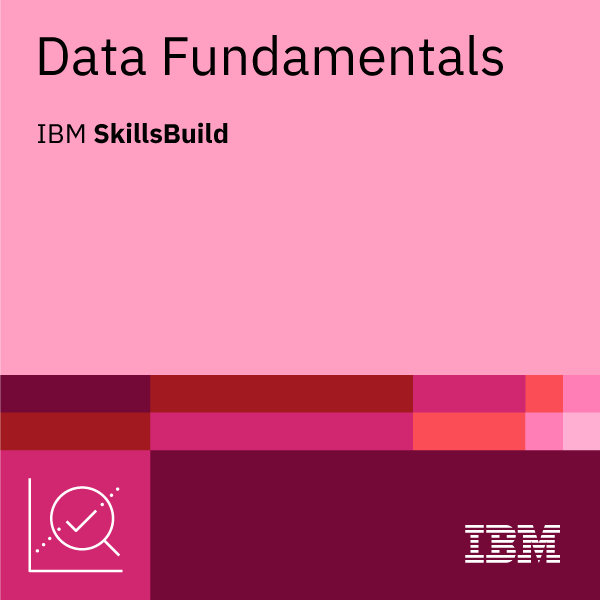
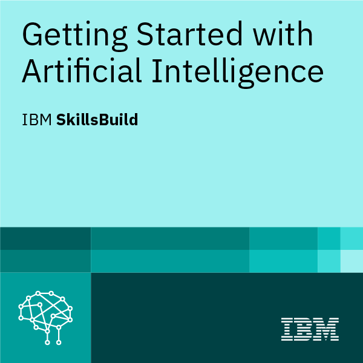
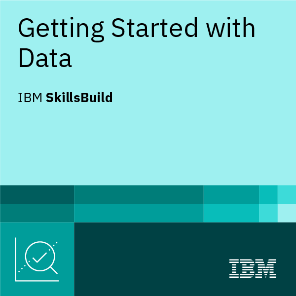

  

<h3>📈 Estudante de Ciências de Dados e Inteligência Artificial</h3>

Sou estudante de Ciências de Dados e Inteligência Artificial no Centro Universitário Fundação Santo André. 
Apaixonado por transformar dados em insights, busco crescimento e aprendizado constante para me tornar um cientista de dados capaz de gerar soluções impactantes.

---

<h3>🚀 Linguagens e Tecnologias</h3>

---

<h3>🎓 Minhas credenciais</h3>

<table>
<tr>
<td align="center">
 
<a href="https://www.credly.com/badges/b93b53c6-f812-4fa8-84e0-a9fe0a17f379/public_url" target="_blank">Ver no Credly</a>
</td>
<td align="center">
 
<a href="https://www.credly.com/badges/3b8e8570-2649-4e90-ad79-cc8e7c84b8bb/public_url" target="_blank">Ver no Credly</a>
</td>
<td align="center">
 
<a href="https://www.credly.com/badges/3dc97af9-188f-4043-8bc0-ef9e58163bbb/public_url" target="_blank">Ver no Credly</a>
</td>
<td align="center">
 
<a href="https://www.credly.com/badges/9cba450e-057b-471a-9765-ba512a606a9b/public_url" target="_blank">Ver no Credly</a>
</td>
</tr>
</table>

---

### 🔭 Projetos
- 📈 [Dashboard de Análise e Previsão de Ações com Machine Learning](https://github.com/Raimundo2004/acoes.git)
- 🚗 [Risco ao Volante](https://github.com/Raimundo2004/ETL-Acidentes.git)
- 🛥️ [Análise/ML com Dados do Titaninc](https://github.com/Raimundo2004/An-lise-de-dados-com-a-base-de-dados-do-Titanic.git)
- 🤖 [Agente de IA Financeiro](https://github.com/Raimundo2004/consultor-financeiro.git)   

---

### 📫 Contato
- Email: **relias.neto2004@gmail.com**  
- LinkedIn: [Raimundo Elias dos Santos Neto](https://www.linkedin.com/in/raimundo-elias-dos-santos-neto)
